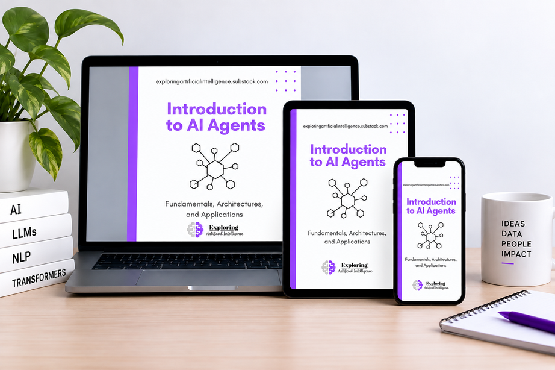

# Introduction to AI Agents

**Fundamentals, Architectures, and Applications**

**English** · [Português](README.pt-BR.md)

A study guide on Artificial Intelligence agents, their core components, reasoning patterns, architectures, and safety mechanisms.

This repository compiles foundational concepts on AI agents into modular Markdown materials featuring straightforward explanations, conceptual diagrams, and learning-focused discussions.

⭐ **Enjoying the content? Give this repository a star to help it grow!**

The content in this repository is based on my ebook [Introduction to AI Agents — Fundamentals, Architectures, and Applications](https://exploringartificialintelligence.substack.com/perks/ffe08dd0-6ca0-47e8-8b7d-550e36a94029).

## 🎯 Goal

The goal of this guide is to help you understand how AI agents work, which components make up their architecture, and how these systems can be designed to execute goal-oriented tasks.

The focus is on fundamentals and architectural decisions, independent of any specific programming language or framework.

**This is conceptual, code-free material**, aimed at understanding the core principles underlying agentic systems.

## 💡 Core Concept

An AI agent is not simply a language model with a prompt. It is a system that combines a goal with context, decision-making capabilities, tools, and execution controls to accomplish a task.

Its architecture must fit the problem: not every application requires an agent, and not every agent requires multiple agents to work effectively.

## Contents

### 1. Fundamentals
- [What are AI agents?](en/chapters/01-fundamentals/01-what-are-ai-agents.md)
- [Chatbots, assistants, and agents: what's the difference?](en/chapters/01-fundamentals/02-chatbots-assistants-and-agents.md)

### 2. Architecture
- [Agent components](en/chapters/02-architecture/03-agent-components.md)
- [LLMs, prompts, memory, and context](en/chapters/02-architecture/04-llms-prompts-memory-and-context.md)
- [Tools, knowledge bases, and orchestration](en/chapters/02-architecture/05-tools-knowledge-bases-and-orchestration.md)

### 3. Reasoning Patterns
- [Reasoning and execution loop](en/chapters/03-reasoning-patterns/06-reasoning-and-execution-loop.md)
- [Reasoning patterns](en/chapters/03-reasoning-patterns/07-reasoning-patterns.md)

### 4. Building Agents
- [Architecture and frameworks](en/chapters/04-building-agents/08-architecture-and-frameworks.md)
- [Agent example in practice](en/chapters/04-building-agents/09-agent-example-in-practice.md)

### 5. Multi-Agent Systems
- [Fundamentals of multi-agent systems](en/chapters/05-multi-agent-systems/10-multi-agent-systems-fundamentals.md)
- [Coordination, communication, and protocols](en/chapters/05-multi-agent-systems/11-coordination-communication-and-protocols.md)

### 6. Security and Governance
- [Evaluation and observability](en/chapters/06-security-and-governance/12-evaluation-and-observability.md)
- [Security, guardrails, and governance](en/chapters/06-security-and-governance/13-security-guardrails-and-governance.md)

### 7. Study Materials
- [Continuing the journey](en/chapters/07-study-materials/14-continuing-your-journey.md)
- [AI agents glossary](en/chapters/07-study-materials/15-ai-agents-glossary.md)
- [Review and key concepts](en/chapters/07-study-materials/16-review-and-key-concepts.md)

## ✨ Further Reading

- [An OpenAI Guide to Building Agents with LLMs](https://exploringartificialintelligence.substack.com/p/an-openai-guide-to-building-agents)
- [The Era of Chatbots Is Over. The Era of AI Agents Has Begun.](https://exploringartificialintelligence.substack.com/p/the-era-of-chatbots-is-over-the-era)
- [The New Era of Software Development: From Vibe Coding to Agentic Engineering](https://exploringartificialintelligence.substack.com/p/the-new-era-of-software-development)
- [When AI Agents Reach Real-World Systems: What the OpenAI and Anthropic Incidents Teach Us](https://exploringartificialintelligence.substack.com/p/when-ai-agents-reach-real-world-systems)
- [The Hidden Cost of Asking AI to Think More](https://exploringartificialintelligence.substack.com/p/the-hidden-cost-of-asking-ai-to-think)

## How to Study

If you are just getting started, we recommend following the content in order:

1. Begin with the fundamentals to understand what characterizes an AI agent.
2. Explore the architecture to discover the components that make execution possible.
3. Study reasoning patterns to understand how agents plan, act, and revise decisions.
4. Learn about building approaches and multi-agent systems.
5. Finish with security, evaluation, and governance.

You can also consult any topic of interest directly.

This material is ideal for anyone studying or working in Artificial Intelligence, Data Science, Software Engineering, and LLM-based application development.

## Continue Your AI Journey

If you want to deepen your understanding and explore more content on Artificial Intelligence, LLMs, and agents, join me in my [newsletter](https://exploringartificialintelligence.substack.com/). ❤️

To read my ebook on [AI Agents](https://exploringartificialintelligence.substack.com/perks) (along with my other ebooks), consider becoming a paid newsletter subscriber.

You can also follow me on [LinkedIn](https://www.linkedin.com/in/elisa-terumi), [Instagram](https://www.instagram.com/elisaterumi.ai/), and [TikTok](https://tiktok.com/@elisaterumi.ai).

Enjoy the guide! 🚀

## Star History

<a href="https://www.star-history.com/?repos=elisaterumi-ai%2Fai-agents-guide&type=date&legend=top-left">
  <picture>
    <source media="(prefers-color-scheme: dark)" srcset="https://api.star-history.com/chart?repos=elisaterumi-ai/ai-agents-guide&type=date&theme=dark&legend=top-left" />
    <source media="(prefers-color-scheme: light)" srcset="https://api.star-history.com/chart?repos=elisaterumi-ai/ai-agents-guide&type=date&legend=top-left" />
    
  </picture>
</a>
