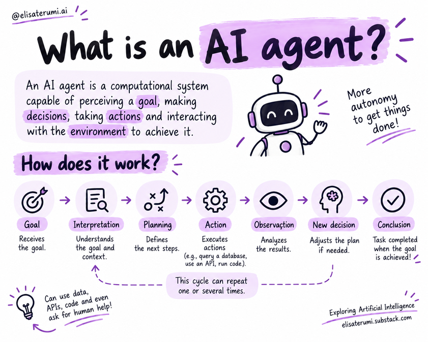

# What are AI Agents?

## Introduction

Artificial Intelligence agents are systems that work toward a goal, making decisions and taking actions to achieve it. Rather than merely producing a response, they can organize steps, use tools, observe outcomes, and decide what to do next.

Large Language Models (LLMs) can serve as part of an agent's interpretation and decision-making engine.

Context, memory, tools, and guardrails complete the architecture according to the needs of the application.

NOTE: Although the concept of agents has existed for decades, this guide focuses on LLM-based agents:

> Systems that combine language models with context, memory, tools, and orchestration mechanisms to execute goal-oriented tasks.

✨ Read more about running LLMs locally:

- [How to Run LLMs Locally with GPT4All](https://exploringartificialintelligence.substack.com/p/how-to-run-llms-locally-with-gpt4all)
- [Running Models Locally with LM Studio](https://exploringartificialintelligence.substack.com/p/running-models-locally-with-lm-studio)
- [Running Models Locally with Ollama](https://exploringartificialintelligence.substack.com/p/running-models-locally-with-ollama)
- [Run AI Models on Your Computer in a Few Clicks](https://exploringartificialintelligence.substack.com/p/run-ai-models-on-your-computer-with)
- [Artificial Intelligence Without Limits: Exploring Llama.cpp](https://exploringartificialintelligence.substack.com/p/artificial-intelligence-without-limits)
- [Discover the Potential of Llamafile](https://exploringartificialintelligence.substack.com/p/discover-the-potential-of-llamafile)

## What Characterizes an Agent?

An agent receives or identifies a goal, interprets what needs to be done, and selects actions to pursue the expected outcome. Unlike an entirely predefined automation, it can determine part of the path during execution.

A conceptual cycle is:

**Goal → Interpretation → Planning → Action → Observation → New Decision → Completion.**

This cycle can repeat. The agent may query a database, call an API, gather information, or request human intervention before proceeding.

## A System, Not Just an LLM

An architecture can bring together:

- **Model:** Interprets information and contributes to decisions.
- **Goal and Instructions:** Guide expected behavior.
- **Context and Memory:** Provide relevant information.
- **Tools:** Enable interaction with external systems.
- **Knowledge Base:** Supplies sources for retrieval, such as via RAG.
- **Orchestration:** Controls workflow and stopping conditions.
- **Security & Safety:** Establishes boundaries for permitted actions.

A useful conceptual representation is: **agent = model + goal + context + tools + execution control**. The actual composition depends on the problem at hand.

## Characteristics

- **Agency:** The ability to act and make decisions on behalf of a user or goal.
- **Autonomy:** The degree of independence to perform tasks without continuous intervention.
- **Self-governance:** Regulating behavior according to established rules and conditions; does not mean unrestricted freedom to alter policies.
- **Reactivity:** Responding to changes in the environment.
- **Proactivity:** Anticipating and planning actions.
- **Social Ability:** Communicating and collaborating with humans or other agents.

## Goal Orientation

A goal can be broken down into subtasks. To prepare a report, for instance, an agent might identify relevant documents, consult sources, extract information, organize findings, and verify whether the report fulfills the request. The sequence is illustrative and may vary depending on the architecture.

## Application Examples

- Scheduling: Checking availability and proposing options.
- Travel planning: Researching and comparing alternatives.
- Purchasing: Checking products and preparing orders, with confirmation before checkout when appropriate.
- Web research: Gathering information across different sources and producing a synthesis.

These capabilities require appropriate tools and permissions; they do not emerge merely from using an LLM.

## When to Use — and When to Avoid

Agents are most valuable when tasks require planning, dynamic decision-making, tool usage, and adaptation during execution. A traditional solution may be preferable when:

- The process is simple and deterministic;
- Steps and rules are fixed;
- There are strict latency requirements;
- The cost of multiple model calls is not justified;
- Actions are high-risk and demand rigorous deterministic controls.

In critical scenarios, the agent can support decision-making while leaving key actions subject to human approval.

## Key Concepts

- Agents are goal-oriented and can execute multi-step workflows.
- An LLM is one potential component, not necessarily the entire system.
- Tools, context, memory, orchestration, and security expand capabilities.
- Autonomy must match the task and associated risks.
- Not every problem requires an agentic architecture.

## Questions for Reflection

1. What is the difference between answering a question and working toward a goal?
2. Why is a standalone LLM not necessarily an agent?
3. When would traditional automation be preferable?
4. Which actions should require human approval?

## Next Step

Read [Chatbots, assistants, and agents: what's the difference?](02-chatbots-assistants-and-agents.md).

## Reference

Educational summary based on *Introduction to AI Agents: Fundamentals, Architectures, and Applications*, by Elisa Terumi Rubel Schneider.
