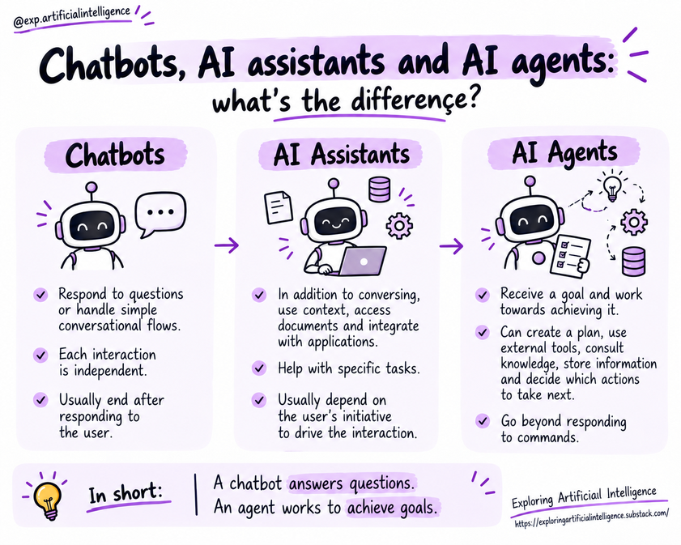

# Chatbots, Assistants, and Agents: What's the Difference?

## Introduction

*Chatbot*, *AI assistant*, and *AI agent* are related terms, but they are not equivalent.

The main difference lies in system behavior: how it uses information, executes tasks, and decides what to do next — not merely in the user interface presented.

## Chatbots

Chatbots are systems primarily designed for conversational interaction. They can answer questions, provide information, and guide users through simple flows, such as clarifying operating hours for a service.

Some rely on predefined rules and decision trees; others use language models.

Therefore, the term primarily describes the form of interaction, rather than a specific underlying technology.

## AI Assistants

Assistants expand conversational interaction with context, documents, and integrations.

They can help analyze a file, organize information, or support a specific task. Generally, the human user directs the interaction and provides additional guidance when needed.

Capabilities vary: an assistant might only generate text responses, or it might also access tools and perform operations.

## AI Agents

Agents work toward an objective.

They can organize steps, choose tools, observe outcomes, and adapt subsequent actions. Depending on their permissions, they can also request clarification or human approval.

Not every agent operates with full autonomy. The level of independence must be defined by the architecture, permissions, and guardrails.

## Comparison

| Aspect | Chatbot | AI Assistant | AI Agent |
|---|---|---|---|
| Typical focus | Conversation and answers | Task support | Achieving a goal through actions |
| Context | Varies | Frequently used | Used according to the task |
| Planning | Can follow predefined flows | Can help organize tasks | Can plan and adapt steps during execution |
| Tools | Optional | Can be integrated | Can form part of the action plan |
| Autonomy | Usually limited in simple solutions | Variable | Variable and controlled |

This table presents common tendencies rather than rigid categories. Real-world capabilities depend on the specific implementation.

## Example: Scheduling a Meeting

- **Chatbot:** Explains how to schedule or guides the user through the process steps.
- **Assistant:** Helps organize preferences and suggests times based on available information.
- **Agent:** With proper integrations and permissions, queries calendars, identifies compatible openings, and drafts an invite, optionally requesting confirmation before sending.

One should not assume that every tool in these categories possesses these capabilities. Accessing calendars and sending invitations require integrations and explicit permissions.

## The Interface Does Not Define the Architecture

An application with a chat window can contain an agent. A system utilizing an LLM might only be a chatbot or assistant. To evaluate a solution, ask:

- Does the system only answer, or does it also execute actions?
- Does it work toward an objective or treat each request in isolation?
- Does it coordinate intermediate steps?
- Does it use external tools?
- Does it observe outcomes and adapt its next moves?
- Which decisions require human approval?

These concepts can also overlap: an assistant might incorporate an agentic component for specific tasks.

## Key Concepts

- Chatbots prioritize conversational interaction.
- Assistants help users with context and task execution.
- Agents can plan and execute goal-oriented actions.
- These terms do not, by themselves, define specific technologies or fixed autonomy levels.
- Evaluation should focus on the actual capabilities and boundaries implemented.

## Questions for Reflection

1. Is a chatbot that queries an API necessarily an agent?
2. Can an assistant incorporate agentic capabilities?
3. Why does using an LLM not automatically make an application an agent?
4. In the scheduling example, which actions should require confirmation?

## Next Step

Proceed to [Agent components](../02-architecture/03-agent-components.md).

## Reference

Educational summary based on *Introduction to AI Agents: Fundamentals, Architectures, and Applications*, by Elisa Terumi Rubel Schneider.
