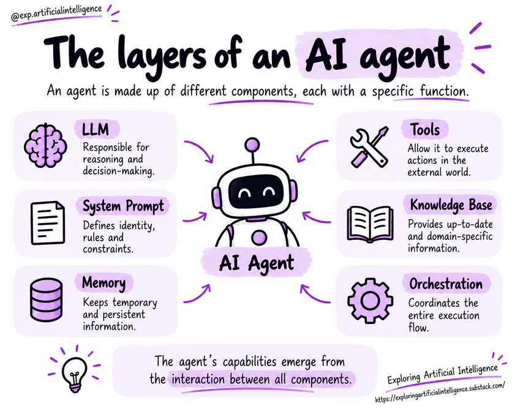

# Agent Components

## Introduction

An agent is a system made up of interconnected elements that work together.

The language model can help interpret requests and select actions, but the application must also define goals, provide context, make tools available, and control execution.

## Core Components

### Language Model (LLM)

The LLM interprets the user request, analyzes available context, and can generate plans or propose next actions.

Because its operation is probabilistic, its responses can also contain misunderstandings or unsuitable decisions.

Furthermore, the model cannot query databases or send messages on its own.

To perform these operations, it relies on tools integrated into the application. The model may request an action; execution takes place within the application components responsible for carrying it out.

### Instructions and System Prompt

Instructions guide the agent's behavior. They can define its role, goals, constraints, and how it should interact with users and tools.

In LLM-based applications, these guidelines are commonly structured within a system prompt.

While the user presents a specific task, this prompt establishes operating principles for the agent.

Clear instructions foster more consistent behavior. Nevertheless, critical constraints must also be enforced by the application layer itself, particularly when dealing with data access or action execution.

### Memory, State, and Context

Memory allows preserving relevant information across a single task or across multiple interactions. It can hold preferences, intermediate results, and data needed later.

State represents the current status of execution: what has already been done, what information is available, and which steps still need completion.

Context supplies relevant information for the current execution step.

It is important to decide what to retain, for how long, and with what safeguards.

### Tools and Orchestration

Tools enable interaction with APIs, files, search engines, databases, and other external services.

They turn an agent's decision into an operation upon the environment.

The orchestration layer coordinates this entire assembly. It manages model calls, runs tools, updates state, and controls continuation and stopping conditions.

It can also organize human checkpoints or coordination with other agents.

### Knowledge Base

Provides reference content. An architecture can retrieve relevant passages from documents before generating an answer, as seen in RAG systems.

### Security and Evaluation

Includes access limits, input and output validation, event logging, automated testing, and supervisory mechanisms.

## How Components Work Together

Consider an agent tasked with answering a question about internal documentation.

The system interprets the question, retrieves pertinent passages, prepares an evidence-based answer, and checks whether sufficient information exists. If it needs to query another service, orchestration determines whether that tool is available and authorized.

The exact workflow depends on the application; there is no single mandatory architecture for all agents.

## Architecture is Not the Same as the Model

Choosing a more capable model may improve performance, but it does not automatically solve issues with integration, context, or tool usage.

The overall quality of an agent depends on how well these components collaborate.

Therefore, designing an agentic system involves not only selecting the model, but also configuring the data, tools, and guardrails required for the task.

> The model is just one part of the system. Two agents can use the exact same LLM and exhibit completely different behaviors due to their prompts, tools, memory, accessible data, execution rules, and controls.

## Design Checklist

- Are the goal and completion criteria clear?
- Does the chosen model fit the task requirements?
- Does the context contain the necessary information?
- Do tools operate with least privilege?
- Are there iteration, time, and cost boundaries in place?
- Does the system know when to stop or ask for help?
- Are tests and logs available to evaluate behavior?

## Key Concepts

- Agents are complete systems, not just prompts or models.
- Components vary depending on the use case.
- Tools connect the agent to external operations.
- Orchestration controls the flow of execution.
- Security and evaluation must be built into the design from the start.

## Questions for Reflection

1. What causes two agents using the same LLM to behave differently?
2. Why can't prompt instructions replace technical permission controls?
3. Which components are required to query internal company documents?

## Next Step

Read [LLMs, prompts, memory, and context](04-llms-prompts-memory-and-context.md).

## Reference

Educational summary based on *Introduction to AI Agents: Fundamentals, Architectures, and Applications*, by Elisa Terumi Rubel Schneider.
