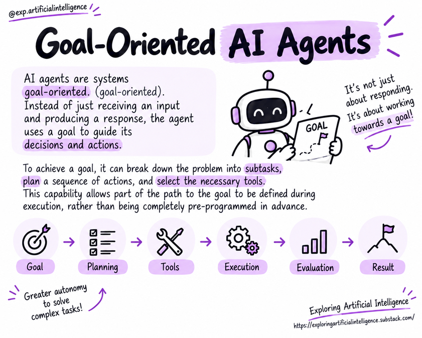

# Reasoning and Execution Loop

## From Goal to Action

Agents tasked with multi-step operations must bridge high-level goals with actionable commands.

An iterative cycle enables the agent to decide, act, observe the outcome, and adapt the next step.

A simplified representation is:

**Goal → Interpretation → Planning → Action → Observation → Evaluation → Next Action or Halt.**

This loop is an architectural abstraction. Concrete implementations can merge steps, repeat operations, or adopt simpler pipelines.

## Stages of the Loop

### 1. Interpret the Goal

The system identifies expected outcomes, constraints, and missing information. If requirements are ambiguous, asking the user for clarification may be necessary.

### 2. Plan

The agent formulates one or more candidate actions. The plan may be established up front or built incrementally as new results unfold.

### 3. Select and Execute an Action

The action might involve querying documents, calling a tool, or replying to the user. Execution must respect established permissions and rate limits.

### 4. Observe the Outcome

The system receives the output of the action. It is critical to differentiate between a requested action and a verified completion: confirmation must originate from the tool or service responsible.

### 5. Evaluate and Decide

The outcome is compared with the target goal. The agent can continue execution, try an alternative approach, ask for clarification, escalate the case, or terminate the task.

### 6. Conclude

Execution must stop when success criteria are fulfilled, when safety/budget limits are hit, or when continuing is deemed unsafe.

## Example: Information Research

A request to compare three options might require determining evaluation criteria, querying sources, structuring results, and identifying gaps.

If a source is unavailable, the system can attempt an alternate authorized source or transparently declare the limitation, rather than inventing facts.

## Stopping Conditions

An agent must maintain explicit criteria to detect when:

- The objective has been successfully met;
- Sufficient information cannot be found;
- A tool has encountered repeated failures;
- Caps on cost, time, or iterations have been exceeded;
- An action requires human approval;
- Continuing introduces risk or unintended side effects.

## Why Does the Loop Require Guardrails?

Iterations can improve response fidelity, but they can also multiply latency, expenses, and potential errors.

An incorrect intermediate finding can cascade into flawed downstream decisions. For that reason, consequential workflows require explicit validations, hard boundaries, and clear success metrics.

## Key Concepts

- The agent continuously alternates between deliberation and environmental interaction.
- Observing intermediate outputs guides subsequent moves.
- Completion should depend on verified criteria, not model self-confidence.
- Constraints on iterations, cost, and risk are vital.

## Questions for Reflection

1. Why is observing a tool's output essential?
2. How do you distinguish a requested action from a completed action?
3. Which boundary conditions should trigger an immediate halt to an agent's loop?

## Next Step

Read [Reasoning patterns](07-reasoning-patterns.md).

## Reference

Educational summary based on *Introduction to AI Agents: Fundamentals, Architectures, and Applications*, by Elisa Terumi Rubel Schneider.
