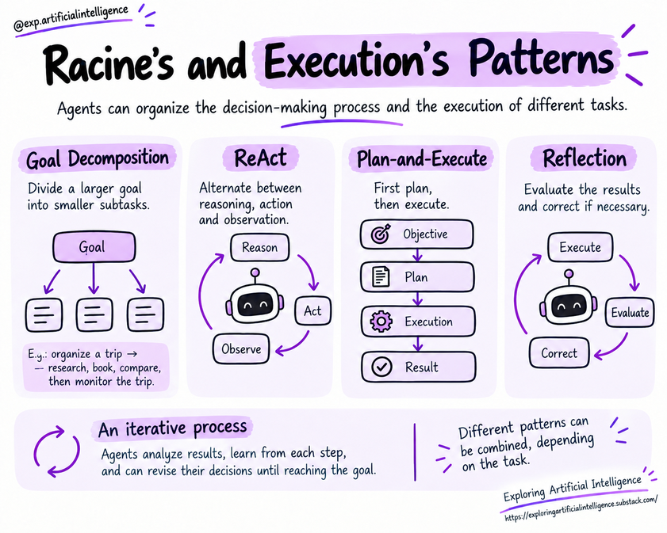

# Reasoning Patterns

## Introduction

Reasoning and execution patterns describe structured methods to organize the interaction between model, tools, and the environment.

The right choice depends on task complexity, the necessity of pre-planning, and acceptable cost/latency profiles.

> The patterns below represent conceptual paradigms. Production systems frequently blend them or implement specialized variants.

Agents can coordinate their decision-making and execution pipelines in multiple ways.

These patterns define how the system decomposes goals, plans actions, employs tools, and evaluates output.

No single pattern fits every scenario.

Selection depends on task complexity, information availability, and requirements around cost, speed, and autonomy.

## Goal Decomposition

**Goal Decomposition** involves breaking down a larger objective into smaller, manageable subtasks.

When asked to organize a trip, for example, the agent can separate transportation research, accommodation selection, and itinerary assembly.

Each sub-problem can be tackled and evaluated independently while respecting task dependencies.

While this partitioning brings structure, the overall output must still satisfy the overarching objective.

Finding a great hotel does not solve the request if it exceeds the user's budget or is situated too far from the desired destination.

## ReAct

The **ReAct** pattern (*Reasoning and Acting*) couples deliberation and action iteratively.

The agent assesses the immediate situation, performs an action, and leverages the observation to shape its next decision.

For instance, it might query a flight API and notice that no flights are available on the requested date. Armed with this finding, it can search alternative allowed dates or ask the user for advice.

This pattern is especially suited for tasks where intermediate results influence subsequent steps.

The solution is constructed incrementally as new information arrives.

## Plan-and-Execute

In the **Plan-and-Execute** pattern, planning is decoupled from execution.

First, the agent maps out all necessary steps required to reach the objective. Next, it executes the planned sequence and monitors results.

This approach grants a macro-level perspective before committing to operations.

It is particularly useful for workflows like comprehensive report writing, which require collecting documents, cross-referencing information, and composing analysis.

The plan can also be dynamically revised. If a data source is unreachable or an intermediate step flags an issue, the system can recalibrate before proceeding.

## Reflection

The **Reflection** pattern introduces an explicit evaluation and self-correction loop.

After generating a candidate result, the agent audits it against defined criteria and can apply corrections before final delivery.

A drafted report can be analyzed to ensure all required talking points are covered and verify that no claim lacks citation from source material.

Reflection can enhance output quality, but it does not guarantee catching all flaws.

Whenever possible, reflection loops should incorporate external verification rules and factual assertions alongside model self-critique. Additionally, the added latency and token costs of multiple passes must be considered.

## Combining Patterns

These patterns are not mutually exclusive.

A unified system can decompose a goal, draft a macro plan, use ReAct during tool queries, and apply reflection to review deliverables before completion.

The guiding goal is choosing an organization that solves the problem while keeping execution transparent and controlled.

## Best Practices

- Start with the simplest pattern capable of solving the task.
- Establish explicit success and termination conditions.
- Validate tool parameters and sanitize outputs.
- Log failures to enable safe recovery paths.
- Continually measure quality, latency, and token expenditure.

## Key Concepts

- Patterns govern how deliberation and action interleave.
- Exhaustive up-front planning is not always feasible or desirable.
- Iterative loops offer flexibility, but necessitate strict boundary controls.
- Self-critique does not eliminate the necessity of independent testing.

## Questions for Reflection

1. When is direct, single-step execution sufficient?
2. What are the advantages of interleaving actions and observations?
3. Why does a model's self-critique fail to guarantee factual correctness?

## Next Step

Proceed to [Architecture and frameworks](../04-building-agents/08-architecture-and-frameworks.md).

## Reference

Educational summary based on *Introduction to AI Agents: Fundamentals, Architectures, and Applications*, by Elisa Terumi Rubel Schneider.
