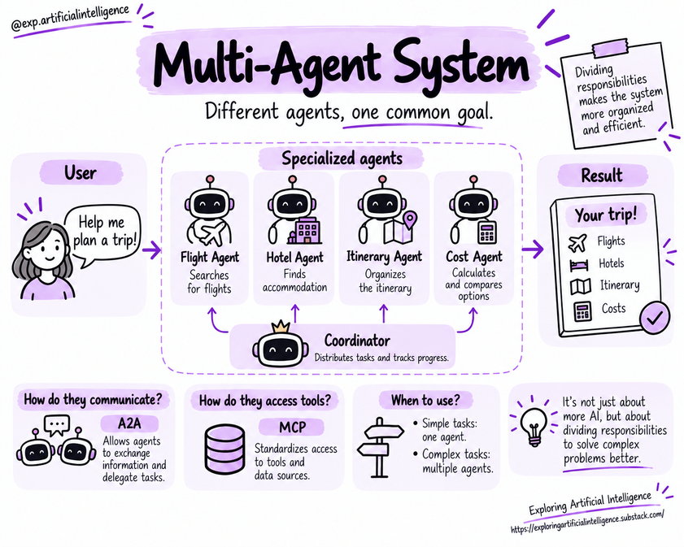

# Fundamentals of Multi-Agent Systems

As an application expands to address multiple distinct responsibilities, dividing work among specialized agents can be beneficial.

This architectural structure is known as a **Multi-Agent System** (MAS).

Instead of centralizing every capability in a single monolithic agent, the system decomposes the problem into smaller parts and coordinates collaboration across them.

## Specialization and Separation of Concerns

Consider a travel concierge application.

One agent might specialize in researching flights, another in hotel accommodations, and a third in weaving those recommendations into a coherent daily itinerary.

Each agent is assigned a tailored goal and equipped with the specific tools and contextual data required for its domain.

This modular separation simplifies system organization, particularly when distinct tasks demand different prompts, tools, or permission boundaries.

Nonetheless, individual outputs must eventually be reconciled. A flight and hotel recommendation only form a viable vacation plan if dates, locations, and costs align seamlessly with user intent.

## Coordination Across Agents

Effective collaboration relies on mechanisms that determine how tasks are delegated, tracked, and assembled.

One common model introduces a centralized orchestrator or coordinator agent. This coordinator interprets the overarching goal, delegates discrete activities to domain workers, and collects findings.

Another common pattern involves direct agent-to-agent delegation, often termed a **handoff**, or running independent subtasks simultaneously in parallel.

These coordination models can be blended.

The optimal strategy depends on task interdependencies and the volume of state that must be shared.

✨ Read more: [Architecture for Multi-Agent Systems with LLMs](https://exploringartificialintelligence.substack.com/p/architecture-for-multi-agent-systems)

## Communication and Context Passing

When delegating a subtask, the delegator must transmit the target objective, operational boundaries, and expected return schema. An agent tasked with hotel searches must be informed of destination, dates, and budget limits.

If vital details are lost in handoff messages, individual agents may execute their portions correctly in isolation, yet produce a combined result that fails the user's requirements.

For this reason, it is critical to distinguish completed, partial, or blocked outcomes.

The coordinating component needs clear signals on what data is trustworthy and what still requires follow-up.

## Potential Benefits

- Decomposition of complex tasks.
- Clean separation of concerns.
- Domain specialization for prompts and tools.
- Independent testability of individual agent modules.

## Costs and Risks

- Increased model calls and higher token costs.
- Higher latency resulting from multi-hop communication.
- Potential inconsistencies between agent opinions.
- Reduced explainability when tracking the root cause of decisions.
- Error propagation cascading across intermediate stages.
- Larger attack surface and more permission boundaries to govern.

## When Should You Use Multiple Agents?

Not every application warrants multiple agents. Multiple agents introduce overhead: extra API calls, inter-agent messaging protocols, and complex synchronization logic.

Agents can also duplicate work or amplify erroneous assumptions between themselves.

For simpler workflows, a single agent with well-defined tools is typically easier to trace, debug, and maintain.

Multi-agent designs shine when addressing concrete needs, such as isolating distinct domain specializations, strict data partitions, or varying privilege levels.

System evaluations must measure the end-to-end outcome. High individual agent scores mean little if collaborative coordination fails to achieve the primary goal.

## Key Concepts

- Multi-agent systems distribute work across autonomous specialized units.
- Specialization demands rigorous contracts and interfaces.
- Coordination introduces real latency and operational costs that must be engineered intentionally.
- More agents do not automatically yield better performance.

## Questions for Reflection

1. Which tasks would genuinely benefit from specialized agents?
2. How can you prevent redundant duplicate work across collaborating agents?
3. What empirical evidence would justify introducing the complexity of multiple agents?

## Next Step

Proceed to [Coordination, communication, and protocols](11-coordination-communication-and-protocols.md).

## Reference

Educational summary based on *Introduction to AI Agents: Fundamentals, Architectures, and Applications*, by Elisa Terumi Rubel Schneider.
