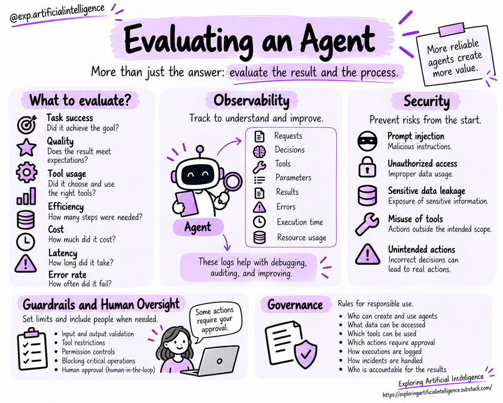

# Evaluation and Observability

## Why Evaluate Agents?

When evaluating a standalone language model, we primarily measure response fluency, coherence, and accuracy.

With an agent, we must also evaluate the chain of decisions, intermediate tool invocations, and environmental side effects that led to that response.

A scheduling agent might craft a polite, grammatically perfect email while scheduling an appointment at the wrong time or with incorrect attendees.

Success must therefore be measured against the real-world outcome: correct invitees, accurate calendar slot, adherence to user constraints, and successful booking confirmation.

Beyond task completion, we must assess tool invocation precision, trajectory length, cost, latency, and failure rates.

These holistic metrics reveal both the quality and operational efficiency of the system.

> Agents combine models, tools, and execution loops. Consequently, evaluating only the final text is insufficient. You must verify whether the system achieved its objective, took correct actions, honored safety limits, and delivered dependable results.

## Defining Success Criteria

Criteria must derive directly from the task specifications. They can include:

- Factual accuracy and relevance of answers;
- Proper citation and utilization of authorized sources;
- Tool invocation success and parameter precision;
- End-to-end task completion rate;
- Adherence to permissions and security policies;
- Latency and token consumption;
- Error frequency and need for human escalation.

No single universal metric covers every agent. Metrics must reflect the operational risks and desired outcomes of the application.

## Evaluation Strategies

### Unit Benchmarks with Golden Sets

Curate representative test cases featuring expected trajectories and outputs. Include standard scenarios, ambiguous requests, partial information inputs, and adversarial out-of-scope prompts.

### End-to-End Trajectory Evaluation

Audit the entire execution flow: inspect tool calls, arguments, returned outputs, intermediate reflections, and termination conditions — rather than simply looking at the final string.

### Regression Testing

Whenever system prompts, models, tool signatures, or orchestrators change, rerun test suites to detect behavioral regressions.

### Human Review

For subjective or high-stakes workflows, human evaluation complements automated heuristics and surfaces edge-case defects that automated metrics overlook.

## Observability

Observability is the ability to understand internal system state and behavior through runtime traces, telemetry, and metrics. For agents, this entails logging:

- Goal description and execution run ID;
- Sequence of reasoning steps and operational decisions;
- Tools invoked alongside exact parameters and payloads;
- Error logs, retries, and termination triggers;
- Execution latency, token counts, and cost estimates;
- Human approvals and final deliverables.

Comprehensive observability makes every trajectory step inspectable.

Traces capture tools used, payloads sent, data received, state changes, errors, and system runtime.

When a task fails, this audit trail allows engineers to diagnose whether failure stemmed from user query interpretation, suboptimal tool selection, or an external service error.

This instrumentation must strictly respect data privacy. Observability requires capturing operational metadata without indiscriminately logging sensitive credentials or private user data.

## Debugging and Improvement

When diagnosing failures, pinpoint where the divergence began: goal interpretation, context assembly, tool selection, action execution, result evaluation, or termination. Reproducing test cases with versioned prompts and tool configurations ensures clear root cause attribution.

## Indicators and Trade-Offs

Enhancing reasoning rigor with multiple critique passes often increases latency and token expenditure. Reducing model calls can speed up execution, but may impair performance on complex edge cases. Evaluation frameworks must weigh these trade-offs holistically.

## Key Concepts

- Evaluate both the final outcome and the procedural steps that produced it.
- Choose metrics tailored to task goals and operational risk profiles.
- Observability accelerates debugging and fuels continuous system refinement.
- Logs must adhere to strict policies around data privacy, retention, and access.

## Questions for Reflection

1. Which metrics are essential when evaluating an internal document research agent?
2. Why are automated regression tests necessary after adjusting a system prompt?
3. What types of sensitive data should be scrubbed or excluded from observability traces?

## Next Step

Read [Security, guardrails, and governance](13-security-guardrails-and-governance.md).

## Reference

Educational summary based on *Introduction to AI Agents: Fundamentals, Architectures, and Applications*, by Elisa Terumi Rubel Schneider.
