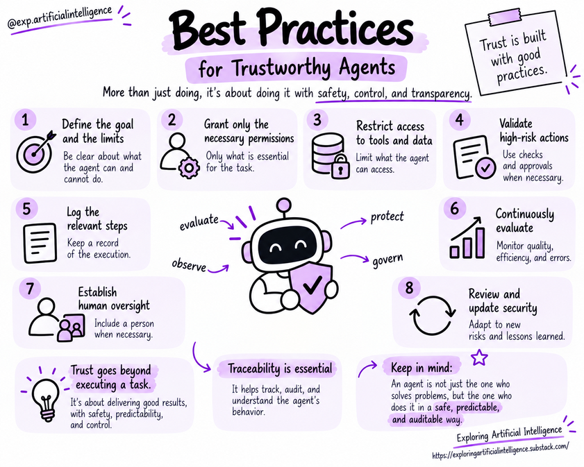

# Security, Guardrails, and Governance

## Security by Design

AI agents can access databases, invoke external tools, and execute transactions across enterprise infrastructure.

While these capabilities unlock tremendous potential, they simultaneously elevate the blast radius of misinterpretations, hallucinations, or unauthorized actions.

Consequently, security and governance cannot be tacked on as an afterthought; they must be engineered into system architecture from day one.

> Agents access real-world tools, private data, and environmental actions. This introduces operational risks well beyond textual hallucination. Security must encompass the model, context injection, tool integrations, permission boundaries, execution runtime, and human supervision.

✨ Read more:

- [AI's Next Big Threat Might Not Be in the Model. But in the Environment.](https://exploringartificialintelligence.substack.com/p/the-next-major-ai-threat-may-not)
- [Surviving the AI Era: What Every Enterprise Needs to Know About LLM Security](https://exploringartificialintelligence.substack.com/p/surviving-the-ai-era-what-every-organization)
- [When AI Agents Reach Real-World Systems: What the OpenAI and Anthropic Incidents Teach Us](https://exploringartificialintelligence.substack.com/p/when-ai-agents-reach-real-world-systems)

## Core Threat Vectors

- **Unauthorized actions:** The agent attempts operations exceeding its sanctioned permissions.
- **Unverified hallucinations:** Plausible but fabricated statements treated as factual ground truth without verification.
- **Prompt injections:** Untrusted external text manipulating the model to bypass safety constraints or leak confidential records.
- **Data leakage:** Sensitive credentials or confidential customer data exposed in context payloads, vector databases, or audit logs.
- **Tool misuse:** Integrations exposing overly permissive write, edit, or delete capabilities without technical restrictions.
- **Unbounded execution loops:** Cycles that fail to terminate, incurring escalating financial costs or cascading failures.

## Guardrails

Guardrails are active enforcement mechanisms designed to constrain and validate system behavior.

They include input sanitization, output filtering, tool schema validation, execution rate limits, and permission boundaries.

Permissions must align strictly with the task at hand. An agent whose job is to retrieve status updates has no architectural need for write or delete access.

Crucially, constraints must be enforced at the engineering runtime layer.

A prompt instruction may provide semantic guidance, but code-level controls must intercept and block unauthorized operations before execution occurs.

> No single guardrail mitigates every threat vector. Defense in depth — layered technical controls — is far more robust than relying on system prompt instructions alone.

## Principle of Least Privilege

Every agent and tool integration should operate strictly with the minimum necessary access rights required to fulfill its specific duties. Segregate read and write credentials, scope API tokens narrowly, and store secrets in secure vaults outside the model's token context.

## Human Supervision

Human oversight can be strategically placed at sensitive decision points within the workflow.

In a **Human-in-the-Loop** (HITL) architecture, the agent conducts preliminary research or drafts actions, but pauses to request explicit human review and authorization before committing sensitive side effects.

An agent might draft an external communication and present the exact recipients and body text for approval prior to dispatch.

This allows the human operator to evaluate concrete, proposed actions and confirm their appropriateness.

Human intervention should be required when:

- An action carries significant financial, legal, or operational impact;
- Retrieved evidence is ambiguous, missing, or contradictory;
- The request falls outside pre-approved operational boundaries;
- An unhandled exception or anomaly is detected;
- Enterprise policy mandates human sign-off.

Approval interfaces should present complete, transparent context so the reviewer understands the proposed action and its downstream implications.

> The depth of human supervision should match potential real-world impact. The harder it is to revert or undo an action, the more vital human approval becomes.

## Governance and Accountability

Governance defines the organizational framework for adopting and running AI agents responsibly.

It establishes clear accountability, access policies, audit procedures, and incident response protocols.

This includes specifying who is authorized to deploy or modify agents, what datasets may be indexed, which tool capabilities require executive approval, and how long execution telemetry must be retained.

It also ensures systems comply with corporate security standards and regulatory mandates.

System reliability relies on unifying these safety controls with robust evaluation and observability.

An agent must generate accurate findings, operate strictly within safe boundaries, and remain completely auditable and interruptible by human operators.

> Governance defines responsibilities, operational policies, permissible usage criteria, and audit processes. It clarifies who signs off on updates, who responds to incidents, how risk assessments are documented, and when architectures must undergo re-evaluation.

## Best Practices

1. Explicitly define permission boundaries and API scopes.
2. Validate and sanitize all tool arguments and responses.
3. Strictly isolate instructions from untrusted data ingested from external sources.
4. Mandate human confirmation for high-stakes or irreversible actions.
5. Set strict execution budgets on runtime duration, cost, and maximum iteration count.
6. Safeguard credentials, personally identifiable information, and telemetry logs.
7. Perform adversarial security testing and monitor anomalies in production.
8. Implement circuit breakers to pause, isolate, or rollback agent operations immediately.

## Key Concepts

- Security must be an architectural priority from the start.
- Guardrails combine technical code-level controls with behavioral policies.
- Least privilege limits the blast radius of errors or compromises.
- Human supervision should scale proportionately with risk.
- Governance ensures organizational accountability and continuous oversight.

## Questions for Reflection

1. Which actions executed by a procurement agent must require human sign-off?
2. Why is a prompt instruction insufficient to protect API credentials?
3. What information is vital for post-incident forensics without leaking private user data in logs?

## Next Step

Read [Continuing your journey](../07-study-materials/14-continuing-your-journey.md).

## Reference

Educational summary based on *Introduction to AI Agents: Fundamentals, Architectures, and Applications*, by Elisa Terumi Rubel Schneider.
