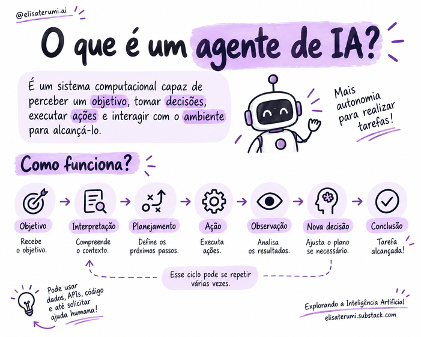

# O que são Agentes de IA?

## Introdução

Agentes de Inteligência Artificial são sistemas que trabalham em direção a um objetivo, tomando decisões e executando ações para alcançá-lo. Em vez de apenas produzir uma resposta, podem organizar etapas, utilizar ferramentas, observar resultados e decidir o que fazer em seguida.

Os Modelos de Linguagem de Grande Escala (*Large Language Models*, ou LLMs) podem funcionar como parte do mecanismo de interpretação e decisão de um agente. 

Contexto, memória, ferramentas e controles completam a arquitetura conforme a necessidade da aplicação.

OBS: Embora o conceito de agentes exista há décadas, neste guia o foco está nos agentes baseados em LLMs: 

> Sistemas que combinam modelos de linguagem com contexto, memória, ferramentas e mecanismos de orquestração para executar tarefas orientadas a objetivos.

✨ Leia mais sobre como rodar LLMs localmente:

- [Como Executar LLMs Localmente com GPT4All](https://elisaterumi.substack.com/p/como-executar-llms-localmente-com)
- [Executando modelos localmente com LM Studio](https://elisaterumi.substack.com/p/executando-modelos-localmente-com)
- [Executando Modelos Localmente com Ollama](https://elisaterumi.substack.com/p/executando-modelos-localmente-com-53a)
- [Execute modelos de IA no seu computador com poucos cliques](https://elisaterumi.substack.com/p/execute-modelos-de-ia-no-seu-computador)
- [Inteligência Artificial sem Limites: Explorando o LLama.cpp](https://elisaterumi.substack.com/p/inteligencia-artificial-sem-limites)
- [Descubra o Potencial do Llamafile](https://elisaterumi.substack.com/p/descubra-o-potencial-do-llamafile)

## O que caracteriza um agente?

Um agente recebe ou identifica um objetivo, interpreta o que precisa ser feito e seleciona ações para buscar o resultado esperado. Diferentemente de uma automação inteiramente predefinida, ele pode determinar parte do caminho durante a execução.

Um ciclo conceitual é:

**Objetivo → interpretação → planejamento → ação → observação → nova decisão → conclusão.**

O ciclo pode se repetir. O agente pode consultar uma base de dados, chamar uma API, buscar informações ou solicitar intervenção humana antes de continuar.

## Um sistema, não apenas um LLM

Uma arquitetura pode reunir:

- **Modelo:** interpreta informações e contribui para decisões.
- **Objetivo e instruções:** orientam o comportamento esperado.
- **Contexto e memória:** disponibilizam informações relevantes.
- **Ferramentas:** permitem interagir com sistemas externos.
- **Base de conhecimento:** oferece fontes para consulta, por exemplo via RAG.
- **Orquestração:** controla o fluxo e as condições de parada.
- **Segurança:** estabelece limites para as ações permitidas.

Uma representação conceitual útil é: **agente = modelo + objetivo + contexto + ferramentas + controle de execução**. A composição real depende do problema.

## Características

- **Agência:** capacidade de agir e tomar decisões em nome de um usuário ou objetivo.
- **Autonomia:** grau de independência para executar tarefas sem intervenção contínua.
- **Auto-governança:** regulação do comportamento segundo regras e condições estabelecidas; não significa liberdade irrestrita para alterar políticas.
- **Reatividade:** resposta a mudanças do ambiente.
- **Proatividade:** antecipação e planejamento de ações.
- **Capacidade social:** comunicação e colaboração com pessoas ou outros agentes.

## Orientação por objetivos

Uma meta pode ser decomposta em subtarefas. Para preparar um relatório, por exemplo, um agente poderia identificar documentos relevantes, consultar fontes, extrair informações, organizar resultados e verificar se o relatório atende à solicitação. A sequência é ilustrativa e pode variar conforme a arquitetura.

## Exemplos de aplicação

- Agendamento: consultar horários e apresentar opções.
- Planejamento de viagens: pesquisar e comparar alternativas.
- Compras: verificar produtos e preparar pedidos, com confirmação antes de uma compra quando necessário.
- Pesquisa na web: reunir informações de diferentes fontes e produzir uma síntese.

Essas capacidades exigem ferramentas e permissões apropriadas; não surgem apenas por se utilizar um LLM.

## Quando usar — e quando evitar

Agentes são mais úteis quando há planejamento, decisões dinâmicas, uso de ferramentas e adaptação durante a execução. Uma solução tradicional pode ser melhor quando:

- o processo é simples e determinístico;
- as etapas e regras são fixas;
- há requisitos rígidos de latência;
- o custo de múltiplas chamadas não se justifica;
- as ações são de alto risco e exigem controles rigorosos.

Em cenários críticos, o agente pode apoiar a decisão, deixando ações importantes sujeitas à aprovação humana.

## Conceitos-chave

- Agentes são orientados a objetivos e podem executar múltiplas etapas.
- Um LLM é um componente possível, não necessariamente o sistema completo.
- Ferramentas, contexto, memória, orquestração e segurança ampliam as capacidades.
- Autonomia deve ser adequada à tarefa e aos riscos.
- Nem todo problema precisa de uma arquitetura agêntica.

## Para refletir

1. Qual é a diferença entre responder a uma pergunta e trabalhar para atingir um objetivo?
2. Por que um LLM isolado não é necessariamente um agente?
3. Quando uma automação tradicional seria preferível?
4. Quais ações deveriam exigir aprovação humana?

## Próximo passo

Leia [Chatbots, assistentes e agentes: qual é a diferença?](02-chatbots-assistentes-e-agentes.md).

## Referência

Resumo didático baseado em *Introdução aos Agentes de IA: Fundamentos, Arquiteturas e Aplicações*, de Elisa Terumi Rubel Schneider.
