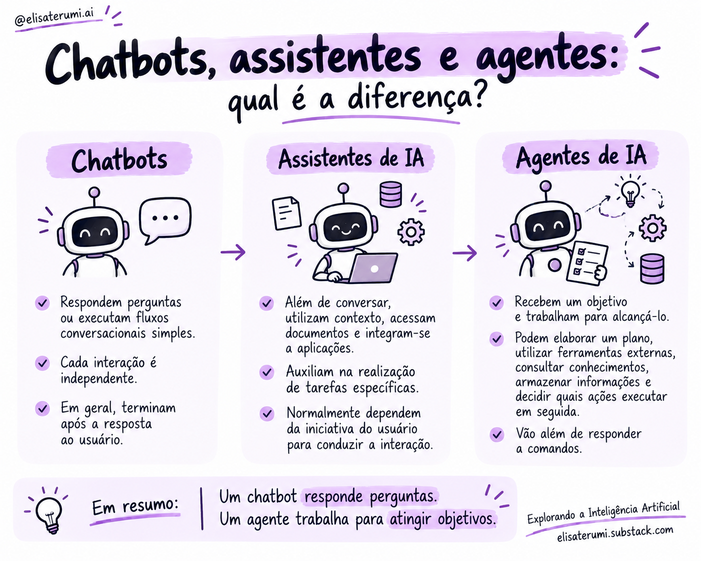

# Chatbots, assistentes e agentes: qual é a diferença?

## Introdução

*Chatbot*, *assistente de IA* e *agente de IA* são termos relacionados, mas não equivalentes. 

A diferença principal está no comportamento do sistema: como ele utiliza informações, executa tarefas e decide o que fazer em seguida — e não apenas na interface apresentada ao usuário.

## Chatbots

Chatbots são sistemas voltados principalmente à interação conversacional. Podem responder perguntas, fornecer informações e conduzir fluxos simples, como esclarecer o horário de funcionamento de um serviço.

Alguns utilizam regras e caminhos definidos previamente; outros empregam modelos de linguagem. 

Portanto, o termo descreve sobretudo a forma de interação, não uma tecnologia específica.

## Assistentes de IA

Assistentes ampliam a interação com contexto, documentos e integrações. 

Podem ajudar a analisar um arquivo, organizar informações ou apoiar uma tarefa específica. Em geral, o usuário conduz a interação e fornece instruções adicionais quando necessário.

As capacidades variam: um assistente pode apenas gerar respostas ou também acessar ferramentas e executar operações.

## Agentes de IA

Agentes trabalham em direção a um objetivo. 

Podem organizar etapas, escolher ferramentas, observar resultados e adaptar as próximas ações. Dependendo das permissões, também podem pedir esclarecimentos ou aprovação humana.

Nem todo agente tem autonomia total. O nível de independência deve ser definido pela arquitetura, pelas permissões e pelos controles.

## Comparação

| Aspecto | Chatbot | Assistente de IA | Agente de IA |
|---|---|---|---|
| Foco típico | Conversa e respostas | Apoio a tarefas | Alcançar um objetivo por meio de ações |
| Contexto | Varia | Frequentemente utilizado | Utilizado conforme a tarefa |
| Planejamento | Pode seguir fluxos predefinidos | Pode ajudar a organizar tarefas | Pode planejar e ajustar etapas durante a execução |
| Ferramentas | Opcionais | Podem ser integradas | Podem fazer parte do plano de ação |
| Autonomia | Geralmente limitada em soluções simples | Variável | Variável e controlada |

A tabela apresenta tendências, não categorias rígidas. As capacidades reais dependem da implementação.

## Exemplo: organizar uma reunião

- **Chatbot:** explica como agendar ou orienta o usuário sobre o processo.
- **Assistente:** ajuda a organizar preferências e sugere horários com base nas informações disponíveis.
- **Agente:** com integrações e permissões adequadas, consulta calendários, identifica horários compatíveis e prepara um convite, podendo solicitar confirmação antes do envio.

Não se deve presumir que qualquer produto dessas categorias tenha tais capacidades. Acesso a calendários e envio de convites exigem integrações e permissões.

## A interface não define a arquitetura

Uma aplicação com janela de chat pode conter um agente. Um sistema que utiliza LLM pode ser apenas um chatbot ou assistente. Para avaliar a solução, pergunte:

- O sistema apenas responde ou executa ações?
- Trabalha em direção a um objetivo ou trata cada solicitação isoladamente?
- Organiza etapas intermediárias?
- Utiliza ferramentas externas?
- Observa resultados e adapta as próximas ações?
- Quais decisões exigem aprovação?

Os conceitos também podem se sobrepor: um assistente pode incorporar um componente agêntico para determinadas tarefas.

## Conceitos-chave

- Chatbots priorizam a interação conversacional.
- Assistentes ajudam o usuário com contexto e tarefas.
- Agentes podem planejar e executar ações orientadas a objetivos.
- Os termos não definem, por si só, tecnologias ou níveis fixos de autonomia.
- A avaliação deve considerar capacidades e limites efetivamente implementados.

## Para refletir

1. Um chatbot que consulta uma API é necessariamente um agente?
2. Um assistente pode incorporar capacidades agênticas?
3. Por que utilizar um LLM não torna automaticamente uma aplicação um agente?
4. Quais ações no exemplo de agendamento deveriam exigir confirmação?

## Próximo passo

Avance para [Componentes de um agente](../02-arquitetura/03-componentes-de-um-agente.md).

## Referência

Resumo didático baseado em *Introdução aos Agentes de IA: Fundamentos, Arquiteturas e Aplicações*, de Elisa Terumi Rubel Schneider.
