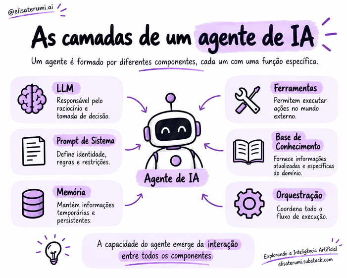

# Componentes de um agente

## Introdução

Um agente é um sistema composto por elementos que trabalham em conjunto. 

O modelo de linguagem pode contribuir para interpretar a solicitação e selecionar ações, mas a aplicação também precisa definir objetivos, fornecer contexto, disponibilizar ferramentas e controlar a execução.

## Componentes principais

### Modelo de linguagem (LLM)

O LLM interpreta a solicitação do usuário, analisa o contexto disponível e pode elaborar planos ou selecionar as próximas ações.

Como seu funcionamento é probabilístico, suas respostas também podem conter interpretações incorretas ou decisões inadequadas.

Além disso, o modelo não consulta bancos de dados nem envia mensagens sozinho.

Para realizar essas operações, ele depende de ferramentas integradas à aplicação. O modelo pode solicitar uma ação; a execução acontece nos componentes responsáveis por realizá-la.

### Instruções e prompt de sistema

As instruções orientam o comportamento do agente. Elas podem definir seu papel, os objetivos, as restrições e a forma como deve interagir com usuários e ferramentas.

Em aplicações baseadas em LLMs, parte dessas orientações costuma ser organizada em um prompt de sistema.

Enquanto o usuário apresenta uma tarefa específica, esse prompt estabelece diretrizes para a atuação do agente.

Instruções claras ajudam a tornar o comportamento mais consistente. Ainda assim, restrições importantes também precisam ser aplicadas pela própria aplicação, especialmente quando envolvem acesso a dados ou execução de ações.

### Memória, estado e contexto

A memória permite preservar informações relevantes durante uma tarefa ou entre diferentes interações. Ela pode guardar preferências, resultados intermediários e dados que serão necessários mais adiante.

O estado representa a situação atual da execução: o que já foi feito, quais informações estão disponíveis e quais etapas ainda precisam ser concluídas.

O contexto fornece informações relevantes para a execução atual. 

É importante decidir o que guardar, por quanto tempo e com quais proteções.

### Ferramentas e rquestração

As ferramentas permitem interagir com APIs, arquivos, mecanismos de busca, bancos de dados e outros serviços.

Elas transformam uma decisão do agente em uma operação sobre o ambiente.

A camada de orquestração coordena esse conjunto. Ela gerencia chamadas ao modelo, executa ferramentas, atualiza o estado e controla as condições de continuidade e parada.

Também pode organizar a participação de pessoas ou de outros agentes.

### Base de conhecimento

Disponibiliza conteúdo de referência. Uma arquitetura pode recuperar trechos relevantes de documentos antes de gerar uma resposta, como ocorre em sistemas RAG.

### Segurança e avaliação

Incluem limites de acesso, validação de entradas e saídas, registro de eventos, testes e mecanismos de supervisão.

## Como os componentes colaboram

Considere um agente que precisa responder a uma pergunta sobre documentos internos. 

O sistema interpreta a pergunta, recupera trechos pertinentes, prepara uma resposta fundamentada e verifica se existem informações suficientes. Se precisar acessar outro serviço, a orquestração determina se a ferramenta está disponível e autorizada.

O fluxo exato depende da aplicação; não existe uma arquitetura única obrigatória para todos os agentes.

## Arquitetura não é o mesmo que modelo

Escolher um modelo mais capaz pode melhorar o desempenho, mas não resolve automaticamente problemas de integração, contexto ou uso de ferramentas.

A qualidade de um agente depende de como esses componentes trabalham juntos.

Por isso, projetar um sistema agêntico envolve tanto a escolha do modelo quanto a definição dos dados, das ferramentas e dos controles necessários para a tarefa.

> O modelo é uma parte do sistema. Dois agentes podem utilizar o mesmo LLM e apresentar comportamentos diferentes por causa de seus prompts, ferramentas, memória, dados acessíveis, regras de execução e controles.

## Checklist de projeto

- O objetivo e os critérios de conclusão estão claros?
- O modelo escolhido atende à tarefa?
- O contexto contém as informações necessárias?
- As ferramentas têm permissões mínimas?
- Há limites de iteração, tempo e custo?
- O sistema sabe quando parar ou pedir ajuda?
- Existem testes e registros para avaliar o comportamento?

## Conceitos-chave

- Agentes são sistemas, não apenas prompts ou modelos.
- Componentes podem variar conforme o caso de uso.
- Ferramentas conectam o agente a operações externas.
- Orquestração controla o fluxo de execução.
- Segurança e avaliação precisam fazer parte do projeto.

## Para refletir

1. O que pode mudar no comportamento de dois agentes que usam o mesmo LLM?
2. Por que instruções em um prompt não substituem controles de permissão?
3. Que componentes seriam necessários para consultar documentos internos?

## Próximo passo

Leia [LLMs, prompts, memória e contexto](04-llms-prompts-memoria-e-contexto.md).
