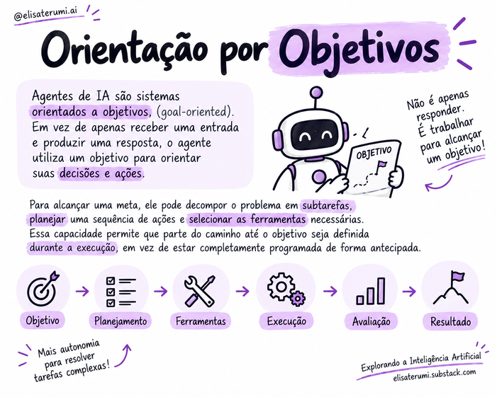

# Ciclo de raciocínio e execução

## Da meta à ação

Agentes que executam tarefas com múltiplas etapas precisam relacionar o objetivo às ações disponíveis. 

Um ciclo iterativo permite decidir, agir, observar o resultado e ajustar o próximo passo.

Uma representação simplificada é:

**Objetivo → interpretação → planejamento → ação → observação → avaliação → próxima ação ou parada.**

O ciclo é uma abstração de projeto. Implementações podem combinar etapas, repetir operações ou utilizar fluxos mais simples.

## Etapas do ciclo

### 1. Interpretar o objetivo

O sistema identifica o resultado esperado, as restrições e as informações que ainda faltam. Se a solicitação for ambígua, pode ser necessário perguntar ao usuário.

### 2. Planejar

O agente define uma ou mais ações possíveis. O plano pode ser detalhado de início ou construído gradualmente, conforme os resultados aparecem.

### 3. Selecionar e executar uma ação

A ação pode ser uma consulta a documentos, uma chamada de ferramenta ou uma resposta ao usuário. A execução deve respeitar as permissões e os limites estabelecidos.

### 4. Observar o resultado

O sistema recebe o resultado da ação. É importante distinguir entre uma ação solicitada e uma ação realmente concluída: a confirmação deve vir da ferramenta ou do sistema responsável.

### 5. Avaliar e decidir

O resultado é comparado com o objetivo. O agente pode continuar, tentar uma alternativa, pedir esclarecimentos, encaminhar o caso ou encerrar a tarefa.

### 6. Encerrar

A execução deve terminar quando os critérios de sucesso forem atendidos, quando um limite for atingido ou quando não for seguro continuar.

## Exemplo: pesquisar informações

Uma solicitação para comparar três opções pode exigir a identificação de critérios, a consulta de fontes, a organização dos resultados e a verificação de lacunas. 

Se uma fonte estiver indisponível, o sistema pode tentar outra fonte autorizada ou informar a limitação, em vez de inventar dados.

## Condições de parada

Um agente deve ter regras para reconhecer quando:

- o objetivo foi atingido;
- não há informações suficientes;
- uma ferramenta falhou repetidamente;
- o limite de custo, tempo ou iterações foi alcançado;
- uma ação exige aprovação humana;
- continuar poderia gerar risco ou efeitos indesejados.

## Por que o ciclo precisa de controle?

Iterações podem melhorar a resposta, mas também podem multiplicar custos e erros. 

Um resultado incorreto pode influenciar a decisão seguinte. Por isso, tarefas relevantes precisam de validações, limites e critérios de sucesso explícitos.

## Conceitos-chave

- O agente alterna entre decisão e interação com o ambiente.
- A observação dos resultados orienta as próximas ações.
- A conclusão deve ser baseada em critérios, não apenas na confiança da resposta.
- Limites de iteração, custo e risco são essenciais.

## Para refletir

1. Por que observar o resultado de uma ferramenta é importante?
2. Como distinguir uma ação solicitada de uma ação concluída?
3. Quais condições deveriam interromper o ciclo de um agente?

## Próximo passo

Leia [Padrões de raciocínio](07-padroes-de-raciocinio.md).
