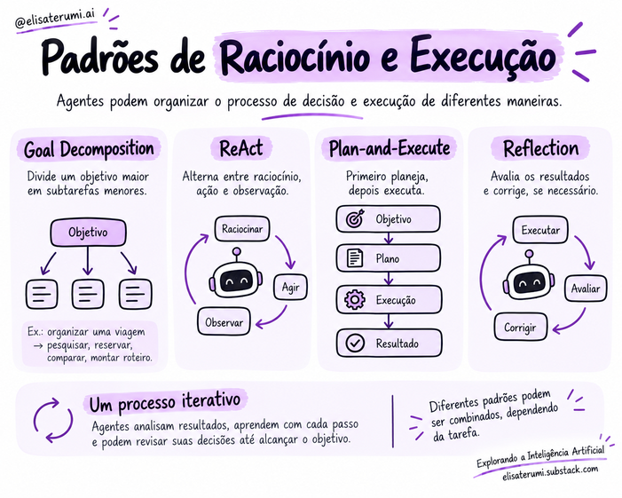

# Padrões de raciocínio

## Introdução

Padrões de raciocínio e execução descrevem maneiras de organizar a interação entre modelo, ferramentas e ambiente. 

A escolha depende da complexidade da tarefa, da necessidade de planejamento e do custo aceitável.

> Os padrões abaixo são modelos conceituais. Sistemas reais podem combiná-los ou adotar variações.

Agentes podem organizar seu processo de decisão e execução de diferentes maneiras. 

Esses padrões ajudam a definir como o sistema divide objetivos, planeja etapas, utiliza ferramentas e revisa os resultados.

Não existe um único padrão adequado para todas as tarefas. 

A escolha depende da complexidade do problema, das informações disponíveis e dos requisitos de custo, latência e autonomia.

## Decomposição de objetivos

A **decomposição de objetivos**, ou *Goal Decomposition*, consiste em dividir uma meta maior em subtarefas menores e mais fáceis de acompanhar.

Diante do objetivo de organizar uma viagem, por exemplo, o agente pode separar a pesquisa de transporte, a escolha de hospedagem e a preparação do itinerário. 

Cada parte pode ser executada e avaliada individualmente, considerando suas dependências.

Essa divisão ajuda a organizar o trabalho, mas o resultado final ainda precisa atender ao objetivo completo. 

Encontrar um bom hotel não resolve a tarefa se ele estiver fora do orçamento ou distante do destino escolhido.

## ReAct

O padrão **ReAct**, de *Reasoning and Acting*, combina raciocínio e ação de forma iterativa. 

O agente analisa a situação, executa uma ação e utiliza o resultado para orientar a próxima decisão.

Por exemplo, ele pode consultar uma API de voos e perceber que não há opções para a data solicitada. A partir dessa informação, pode buscar outra data autorizada ou pedir uma orientação ao usuário.

Esse padrão é útil quando os resultados intermediários influenciam o caminho da execução. 

A solução vai sendo construída à medida que novas informações são obtidas.

## Plan-and-Execute

No padrão **Plan-and-Execute**, o planejamento é separado da execução. 

Primeiro, o agente organiza as etapas necessárias para alcançar o objetivo. Depois, executa o plano e acompanha os resultados.

Essa abordagem permite estabelecer uma visão mais ampla da tarefa antes de começar. 

Ela pode ser útil, por exemplo, na elaboração de um relatório que exige reunir documentos, comparar informações e preparar uma análise.

O plano também pode ser revisado. Se uma fonte não estiver disponível ou uma etapa revelar um problema, o sistema precisa considerar essa mudança antes de continuar.

## Reflection

O padrão **Reflection** acrescenta uma etapa de avaliação e revisão. 

Depois de produzir um resultado, o agente o analisa de acordo com critérios definidos e pode propor correções antes de finalizar.

Um relatório pode ser revisado para verificar se todos os tópicos solicitados foram incluídos ou se existem afirmações sem suporte nas fontes consultadas.

Essa revisão pode melhorar a qualidade, mas não garante que os erros serão identificados. 

Sempre que possível, ela deve utilizar evidências e verificações externas, além da avaliação do próprio modelo. Também é necessário considerar o aumento de custo e tempo provocado por novas etapas.

## Combinando padrões

Esses padrões não são mutuamente exclusivos. 

Um mesmo sistema pode decompor o objetivo, elaborar um plano, utilizar ReAct durante a consulta de informações e revisar a entrega antes de concluir.

O importante é escolher uma organização que ajude a resolver a tarefa, mantendo a execução compreensível e controlada.

## Boas práticas

- Escolha o padrão mais simples que resolva a tarefa.
- Defina critérios de sucesso e parada.
- Valide chamadas de ferramentas e seus resultados.
- Registre falhas e permita recuperação controlada.
- Meça qualidade, latência e custo.

## Conceitos-chave

- Padrões estruturam a interação entre decisão e execução.
- Planejar tudo antecipadamente nem sempre é possível ou desejável.
- Ciclos iterativos favorecem adaptação, mas exigem limites.
- Verificação adicional não elimina a necessidade de testes independentes.

## Para refletir

1. Quando a execução direta é suficiente?
2. Qual é a vantagem de intercalar ações e observações?
3. Por que a autocrítica de um modelo não é garantia de correção?

## Próximo passo

Avance para [Arquitetura e frameworks](../04-construcao-de-agentes/08-arquitetura-e-frameworks.md).
