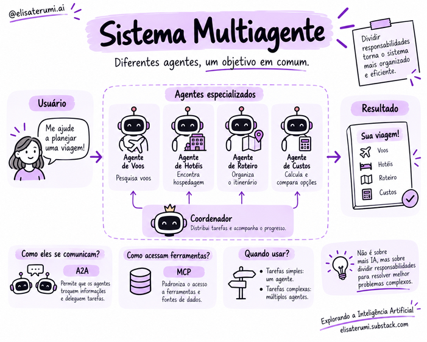

# Fundamentos de sistemas multiagentes

À medida que uma aplicação precisa lidar com diferentes responsabilidades, pode ser útil distribuir o trabalho entre agentes especializados. 

Essa organização é conhecida como **sistema multiagente**, ou *Multi-Agent System*.

Em vez de concentrar todas as atividades em um único agente, o sistema divide o problema em partes e coordena a colaboração entre elas.

## Especialização e divisão de responsabilidades

Imagine um assistente de viagens. 

Um agente pode pesquisar voos, outro consultar hospedagens e um terceiro organizar o itinerário a partir dos resultados encontrados.

Cada agente recebe um objetivo específico e pode ter acesso às ferramentas e informações necessárias para sua parte da tarefa. 

Essa separação pode facilitar a organização da aplicação, especialmente quando as atividades exigem contextos ou permissões diferentes.

Ainda assim, os resultados precisam ser integrados. Um voo e uma hospedagem só formam uma opção útil quando suas datas, localização e custos são compatíveis com o pedido do usuário.

## Coordenação entre agentes

A colaboração depende de mecanismos que definam como as tarefas serão distribuídas e como o progresso será acompanhado.

Uma possibilidade é utilizar um coordenador, responsável por receber o objetivo principal, delegar atividades e reunir os resultados. 

Os agentes especializados executam suas partes e retornam as informações necessárias para a continuidade do processo.

Também existem organizações em que um agente transfere a responsabilidade para outro, em uma operação chamada **handoff**, ou em que subtarefas independentes são executadas em paralelo.

Essas formas de coordenação podem ser combinadas. 

A escolha depende das relações entre as tarefas e da necessidade de compartilhar informações.

✨ Leia mais: [Arquitetura para Sistemas Multi-Agentes com LLMs](https://elisaterumi.substack.com/p/arquitetura-para-sistemas-multi-agentes)

## Comunicação e contexto

Ao delegar uma atividade, é necessário informar o objetivo, as restrições e o resultado esperado. O agente responsável por pesquisar hotéis, por exemplo, precisa conhecer o destino, o período e o orçamento disponível.

Se essas informações forem perdidas na comunicação, cada agente pode executar corretamente sua parte e, mesmo assim, produzir um conjunto incompatível com a necessidade do usuário.

Por isso, também é importante distinguir resultados concluídos, parciais ou bloqueados. 

O componente que coordena a execução precisa saber o que pode utilizar e o que ainda exige outra ação.

## Benefícios possíveis

- Divisão de tarefas complexas.
- Separação de responsabilidades.
- Especialização por domínio ou função.
- Possibilidade de avaliação independente de determinadas etapas.

## Custos e riscos

- Mais chamadas a modelos e maior custo.
- Latência adicional pela comunicação.
- Resultados inconsistentes entre agentes.
- Dificuldade de rastrear a origem de uma decisão.
- Propagação de erros de uma etapa para outra.
- Maior superfície de ataque e mais permissões a administrar.

## Quando usar múltiplos agentes?

Nem toda aplicação se beneficia dessa divisão. Múltiplos agentes acrescentam chamadas ao modelo, troca de mensagens e mecanismos de coordenação. 

Também podem repetir trabalho ou propagar informações incorretas entre si.

Para tarefas simples, um único agente costuma ser mais fácil de acompanhar e manter. 

A divisão passa a fazer sentido quando resolve uma necessidade concreta, como separar especialidades, contextos ou permissões.

A avaliação deve considerar o resultado do sistema completo. O desempenho de cada agente, isoladamente, não garante que a colaboração atinja o objetivo principal.

## Conceitos-chave

- Sistemas multiagentes distribuem trabalho entre agentes.
- Especialização exige responsabilidades e interfaces claras.
- Coordenação tem custo e precisa ser projetada.
- Mais agentes não significam automaticamente melhor desempenho.

## Para refletir

1. Que tarefa se beneficiaria de agentes especializados?
2. Como evitar duplicação de trabalho?
3. Que evidências justificariam a complexidade adicional?

## Próximo passo

Avance para [Coordenação, comunicação e protocolos](11-coordenacao-comunicacao-e-protocolos.md).
