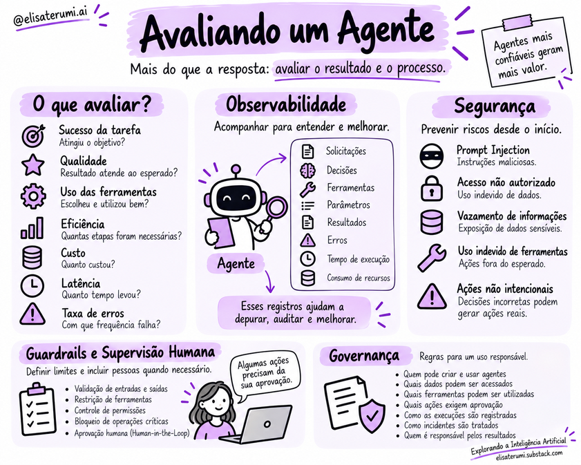

# Avaliação e observabilidade

## Por que avaliar agentes?

Na avaliação de um modelo de linguagem isolado, muitas vezes analisamos principalmente a qualidade da resposta.

Em um agente, também precisamos considerar as decisões e ações realizadas para chegar até ela.

Um agente de agendamento pode apresentar uma mensagem bem escrita e, ainda assim, criar o evento em um horário incorreto.

Por isso, o sucesso precisa ser definido a partir do resultado esperado: participantes corretos, duração adequada, respeito às restrições e confirmação da operação.

Além do sucesso da tarefa, podemos avaliar o uso das ferramentas, o número de etapas, o custo, a latência e a frequência de erros.

Essas medidas ajudam a entender tanto a qualidade quanto a eficiência do sistema.

> Agentes combinam modelos, ferramentas e fluxos de execução. Por isso, avaliar apenas a qualidade textual da resposta não é suficiente. É necessário verificar se o sistema atingiu o objetivo, executou as ações corretas, respeitou os limites e apresentou resultados confiáveis.

## Definir critérios de sucesso

Os critérios devem derivar da tarefa. Podem incluir:

- correção e relevância da resposta;
- uso adequado de fontes;
- sucesso das chamadas a ferramentas;
- conclusão da tarefa;
- respeito às permissões e políticas;
- latência e custo;
- frequência de erros e necessidade de intervenção humana.

Não existe uma métrica única adequada para todos os agentes. Os indicadores devem refletir os riscos e resultados esperados da aplicação.

## Estratégias de avaliação

### Testes com casos conhecidos

Utilize exemplos representativos com resultados esperados ou critérios de avaliação previamente definidos. Inclua casos simples, ambíguos, incompletos e fora do escopo.

### Avaliação de ponta a ponta

Verifique o resultado completo, incluindo a sequência de ações, as ferramentas utilizadas e a condição de encerramento — não apenas uma resposta intermediária.

### Testes de regressão

Após alterar prompts, modelos, ferramentas ou fluxos, repita um conjunto de testes para identificar mudanças inesperadas.

### Revisão humana

Para tarefas subjetivas ou de alto impacto, a avaliação humana pode complementar métricas automatizadas e ajudar a identificar falhas que os testes não capturam.

## Observabilidade

Observabilidade é a capacidade de compreender o comportamento do sistema a partir dos registros e sinais produzidos durante a execução. Para agentes, pode envolver:

- objetivo e identificador da execução;
- etapas e decisões operacionais relevantes;
- ferramentas chamadas e respectivos resultados;
- erros, tentativas e condições de parada;
- latência, consumo e custo estimado;
- intervenções humanas e resultado final.

A observabilidade permite acompanhar as etapas realizadas pelo agente.

Os registros podem incluir ferramentas utilizadas, parâmetros enviados, resultados recebidos, alterações de estado, erros, tempo de execução e consumo de recursos.

Essas informações ajudam a reconstruir o caminho percorrido. Se uma tarefa falhar, podemos investigar se o problema surgiu na interpretação do pedido, na escolha de uma ferramenta ou na resposta de um serviço externo.

Esse acompanhamento deve considerar a proteção de dados sensíveis. Registrar uma execução não significa armazenar indiscriminadamente todo o conteúdo acessado pelo agente.

## Depuração e melhoria

Quando ocorre uma falha, procure identificar em que etapa ela começou: interpretação do objetivo, recuperação de contexto, seleção de ferramenta, execução, avaliação do resultado ou encerramento. Reproduzir o cenário e registrar versões de componentes ajuda a distinguir causas.

## Indicadores e trade-offs

Melhorar a qualidade pode aumentar latência e custo. Reduzir chamadas pode tornar o sistema mais rápido, mas diminuir sua capacidade de resolver casos complexos. A avaliação deve considerar essas dimensões em conjunto.

## Conceitos-chave

- Avalie o resultado final e o processo que levou a ele.
- Métricas devem corresponder ao objetivo e aos riscos.
- Observabilidade facilita diagnóstico e melhoria contínua.
- Logs precisam respeitar privacidade, acesso e retenção.

## Para refletir

1. Que métricas seriam relevantes para um agente de pesquisa documental?
2. Por que testes de regressão são importantes após mudar um prompt?
3. Quais dados não deveriam ser registrados em logs?

## Próximo passo

Leia [Segurança, guardrails e governança](13-seguranca-guardrails-e-governanca.md).
