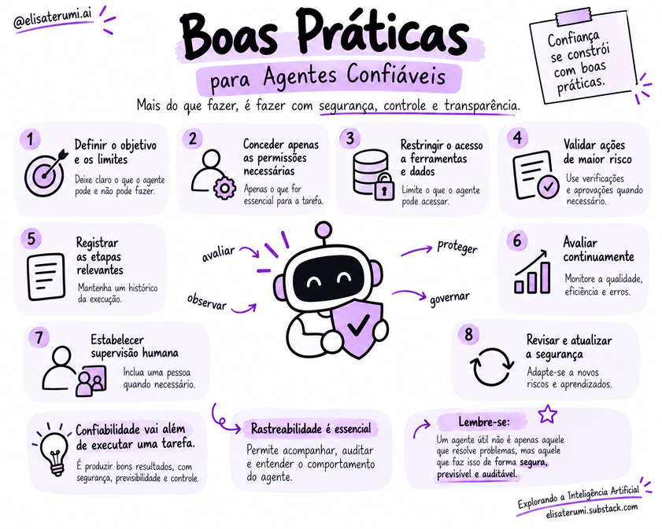

# Segurança, guardrails e governança

## Segurança desde o projeto

Agentes de IA podem acessar dados, utilizar ferramentas e executar ações em sistemas externos.

Essa capacidade amplia suas aplicações, mas também aumenta o impacto de interpretações incorretas ou operações inadequadas.

Por isso, segurança e governança precisam fazer parte da arquitetura desde o início.

> Agentes podem acessar dados, chamar ferramentas e executar ações. Isso cria riscos que não se limitam ao conteúdo gerado pelo modelo. A segurança deve abranger o modelo, o contexto, as integrações, as permissões, a execução e a supervisão.

✨ Leia mais:

- [A próxima grande ameaça da IA talvez não esteja no modelo. Mas no ambiente.](https://elisaterumi.substack.com/p/a-proxima-grande-ameaca-da-ia-talvez)
- [Sobrevivendo à Era da IA: o que toda empresa precisa saber sobre segurança em LLMs](https://elisaterumi.substack.com/p/sobrevivendo-a-era-da-ia-o-que-toda)
- [Quando agentes de IA começam a atacar sistemas reais: o que os incidentes da OpenAI e Anthropic nos ensinam](https://elisaterumi.substack.com/p/quando-agentes-de-ia-comecam-a-atacar)
  
## Principais riscos

- **Ações não autorizadas:** o agente tenta executar uma operação além do escopo permitido.
- **Informações incorretas:** uma resposta plausível é tratada como fato sem verificação.
- **Instruções maliciosas:** conteúdo externo tenta induzir o agente a ignorar as regras ou revelar dados.
- **Exposição de dados:** contexto, memória ou logs contêm informações sensíveis sem proteção adequada.
- **Uso indevido de ferramentas:** integrações permitem alterações ou acessos desnecessários.
- **Execução sem término:** o sistema repete ações, aumenta custos ou não conclui a tarefa.

## Guardrails

Guardrails são mecanismos utilizados para estabelecer limites e validar o comportamento do sistema.

Eles podem incluir validação de entradas e saídas, restrição de ferramentas, limites de execução e bloqueio de operações não autorizadas.

As permissões devem ser compatíveis com a tarefa. Um agente que apenas consulta informações não precisa, necessariamente, de acesso para alterá-las ou excluí-las.

Também é importante que os controles sejam aplicados pelos componentes responsáveis pela execução.

Uma instrução textual ajuda a orientar o modelo, mas uma operação sem autorização deve ser impedida pela aplicação.

> Não existe um único guardrail capaz de resolver todos os riscos. Controles em camadas são mais robustos do que depender exclusivamente de instruções no prompt.

## Princípio do menor privilégio

Cada agente e ferramenta deve ter apenas os acessos necessários à tarefa. Sempre que possível, separe operações de leitura e escrita, limite os recursos disponíveis e proteja credenciais fora do contexto do modelo.

## Supervisão humana

A participação humana pode ser incorporada em momentos específicos do fluxo.

Em uma abordagem Human-in-the-Loop, o agente realiza parte do trabalho e solicita revisão ou aprovação antes de determinadas ações.

Um agente pode preparar uma mensagem e apresentar seus destinatários e conteúdo antes do envio.

Dessa forma, a pessoa consegue avaliar uma ação concreta e decidir se ela corresponde ao que deseja.

A intervenção humana pode ser necessária quando:

- a ação tem consequências financeiras, legais ou operacionais relevantes;
- a evidência é insuficiente ou contraditória;
- a solicitação está fora do escopo previsto;
- o agente detecta uma situação inesperada;
- a política da organização exige aprovação.

A aprovação deve apresentar informações suficientes para que a pessoa compreenda a ação proposta e suas consequências.

> O nível de supervisão deve considerar o impacto potencial da operação. Quanto mais difícil for corrigir uma ação ou reverter seus efeitos, maior tende a ser a necessidade de validação.

## Governança e responsabilidade

A governança define como os agentes podem ser utilizados dentro de uma organização.

Ela estabelece responsabilidades, regras de acesso e processos para acompanhar resultados e tratar incidentes.

Isso inclui definir quem pode configurar agentes, quais dados podem ser utilizados, quais ações exigem aprovação e como os registros de execução serão mantidos.

Também é necessário considerar as políticas internas e os requisitos aplicáveis ao contexto da organização.

A confiabilidade depende da combinação desses elementos com avaliação e observabilidade.

Um agente precisa produzir resultados adequados, operar dentro de limites definidos e permitir que sua atuação seja acompanhada e corrigida quando necessário.

> Governança define responsabilidades, políticas, critérios de uso e processos de acompanhamento. Deve esclarecer quem aprova mudanças, quem responde por incidentes, como riscos são documentados e quando o sistema precisa ser reavaliado.

## Boas práticas

1. Defina limites e permissões explícitos.
2. Valide os argumentos e resultados das ferramentas.
3. Separe instruções de dados não confiáveis recuperados de fontes externas.
4. Exija confirmação para ações críticas ou irreversíveis.
5. Defina limites de tempo, custo e iterações.
6. Proteja dados, credenciais e registros.
7. Teste cenários adversos e monitore falhas em produção.
8. Tenha um procedimento para suspender ou reverter ações quando possível.

## Conceitos-chave

- Segurança deve fazer parte da arquitetura desde o início.
- Guardrails combinam controles técnicos e regras de uso.
- Menor privilégio reduz o impacto de falhas.
- Supervisão humana deve ser proporcional ao risco.
- Governança define responsabilidades e acompanhamento contínuo.

## Para refletir

1. Quais ações de um agente de compras deveriam exigir aprovação?
2. Por que um prompt não é suficiente para proteger credenciais?
3. Que informações são necessárias para investigar um incidente sem registrar dados em excesso?

## Próximo passo

Leia [Continuando a jornada](../07-material-de-estudo/14-continuando-sua-jornada.md).
